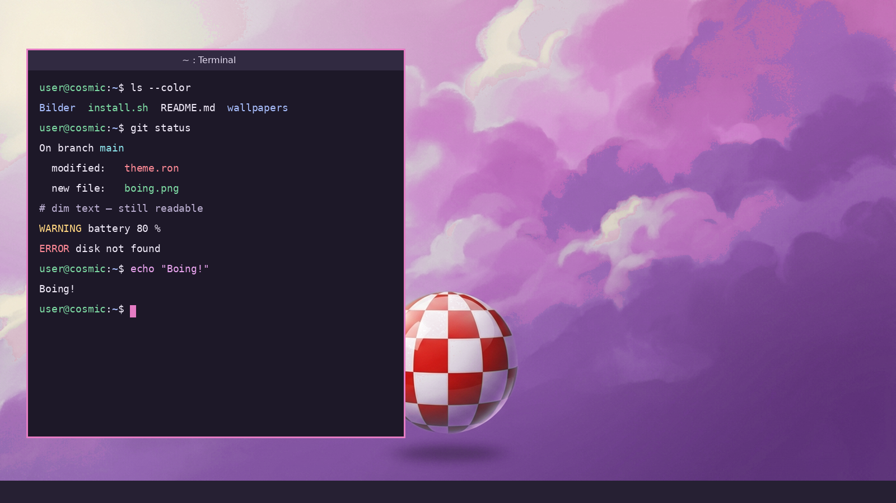

# Amiga-inspired Lila Night – a COSMIC theme

A dark (but not black) theme for the **COSMIC desktop**, inspired by AmigaOS 3.1 / 4.1:
deep plum windows, lavender accents, a turquoise frame around the active window, glossy 2008-style
icons, a lilac cloud sky with the famous checkered ball – and a terminal that is easy on the eyes.



*Deutsch weiter unten.*

## What's inside

| Part | File(s) | Notes |
|---|---|---|
| COSMIC colors (dark + matching light) | `cosmic/` | builder + pre-built theme, no compiling needed |
| Single theme file for *Settings → Appearance → Import* | `cosmic/amiga-inspired-lila-night.ron` | same file as on cosmic-themes.org |
| Terminal colors (COSMIC Terminal) | `terminal/` | *the* highlight – readable dim text, soft pink cursor |
| Wallpapers | `wallpapers/` | lilac clouds with checkered ball (+ darker variant) |
| Glossy icons | `icons/Amiga-Glanz/` | uses **Oxygen** icons, Papirus as fallback, COSMIC apps mapped to Oxygen |
| Big red mouse pointer (optional) | `cursor/make-red-cursor.py` | recolors your local Adwaita cursors, size 48 |
| Firefox theme | `firefox/`, `firefox-amiga-lila-night.xpi` | terminal colors in the browser, lilac cloud strip behind the tabs |
| Claude Code colors (optional) | `claude-code/amiga-night.json` | matching theme for the Claude Code CLI |
| Rebuild tool (optional) | `tools/cosmic-theme-rebuild/` | rebuilds the COSMIC theme after editing builder files, exports `.ron` |

## Install

Requirements: COSMIC (tested with **COSMIC 1.10 on Fedora 44**), `oxygen-icon-theme` and `papirus-icon-theme`
(Fedora: `sudo dnf install oxygen-icon-theme papirus-icon-theme`; Debian/Ubuntu: `oxygen-icon-theme papirus-icon-theme`).

```bash
git clone https://github.com/blazingfarts/amiga-inspired-lila-night
cd amiga-inspired-lila-night
bash install.sh                      # colors, terminal, wallpaper, icons
bash install.sh --with-cursor        # + big red mouse pointer
bash install.sh --with-claude-code   # + Claude Code colors
```

Your current look is backed up to `~/.config/cosmic-backup-<date>/` first. Log out and back in once afterwards.

**Only the colors?** Settings → Appearance → Import → `cosmic/amiga-inspired-lila-night.ron`.
**Only the terminal?** COSMIC Terminal → Settings → Color schemes → Import → `terminal/amiga-inspired-lila-night-terminal.ron`.

## Firefox

The Firefox theme uses exactly the terminal colors: night-violet tab bar with a subtle lilac cloud strip,
plum active tab with a pink line, lavender focus ring in the address bar.

- **From addons.mozilla.org:** https://addons.mozilla.org/firefox/addon/amiga-inspired-lila-night/ (in review – live once Mozilla approves it)
- **Manually (Fedora and other builds that allow unsigned add-ons in the app folder):**
  ```bash
  sudo install -m 644 firefox-amiga-lila-night.xpi \
    "/usr/lib64/firefox/browser/extensions/amiga-lila-night@blazingfarts.xpi"
  ```
  Restart Firefox, then *Add-ons and themes → Themes → Enable*.
- **Just try it:** `about:debugging` → *This Firefox* → *Load Temporary Add-on* → pick `firefox/manifest.json` (until restart).

## Palette

| | Hex |
|---|---|
| Background | `#262033` |
| Containers | `#312A41` / `#3B3350` |
| Accent (lavender) | `#B48CF2` |
| Active window frame | COSMIC turquoise `#63D0DF` (COSMIC 1.10 draws the frame from its own theme format; it fits nicely) |
| Pink highlight (terminal cursor) | `#E57CC4` |
| Success / Warning / Error | `#5CC48A` / `#F0B44C` / `#F06A7A` |
| Terminal background / text | `#1D1828` / `#F0EAF8` |

---

## Deutsch

Ein dunkles (aber nicht schwarzes) Theme für **COSMIC**, angelehnt an AmigaOS 3.1/4.1: Fenster in Pflaume,
Lavendel-Akzente, türkiser Rahmen ums aktive Fenster, glänzende Symbole wie 2008, lila Wolkenhimmel mit Boing-Ball –
und ein Terminal, das die Augen schont.

Installation: siehe oben (`bash install.sh`, optional `--with-cursor`, `--with-claude-code`). Für Firefox gibt es ein passendes Theme in den Konsolenfarben (Abschnitt *Firefox*). Vorher wird dein
aktueller Look nach `~/.config/cosmic-backup-<datum>/` gesichert. Danach einmal ab- und anmelden.

## Credits & licenses

- Theme files, scripts and the rebuild tool: **MIT** (see `LICENSE`). The Firefox theme on addons.mozilla.org is listed under **CC BY 4.0** (Mozilla only allows Creative Commons licenses for themes). The rebuild tool uses libcosmic (MPL-2.0).
- Wallpapers: AI-generated (Google Gemini) and recolored by hand; free to use.
- Icons are **not** included – they come from your distro's Oxygen (LGPL) and Papirus (GPL-3) packages.
- The red cursor is generated locally from your Adwaita cursors (CC-BY-SA 3.0 / LGPL-3); no cursor files are shipped.
- This is a fan theme. *Amiga* and *AmigaOS* are trademarks of their respective owners; not affiliated or endorsed.

## Contributing

Bug reports, ports to other desktops and distro fixes are welcome; the design direction stays with the maintainer. See [`CONTRIBUTING.md`](CONTRIBUTING.md).

## KDE Plasma 6

Portierung in [`kde/`](kde/) – ein Skript setzt Farbschema, Plasma-Stil, Konsole, Hintergrund, Symbole, roten Zeiger, Fensterdeko (Klassy: lila Titel, türkiser Rahmen + Knöpfe wie unter COSMIC 1.10) und Claude-Code-Theme: `./kde/install.sh`. Details: [`kde/README-kde.md`](kde/README-kde.md).
